# Frontend System Design & Architecture


Welcome to the **Frontend System Design & Architecture** reference repository! This repository contains structured study notes, visual breakdowns, architectural trade-offs, and practical frameworks designed for deep conceptual mastery and practical problem-solving across modern client-side architectures (**RADIO Framework**, **Performance Optimization**, **Rendering Strategies**, **Client-Side Caching**, and **Scalable Web Applications**).

> **Author:** Kamal Aboueid  
> **Topics:** Frontend System Design & System Architecture  
> **Status:** Active Learning & Hands-on Reference

---

# The RADIO Framework

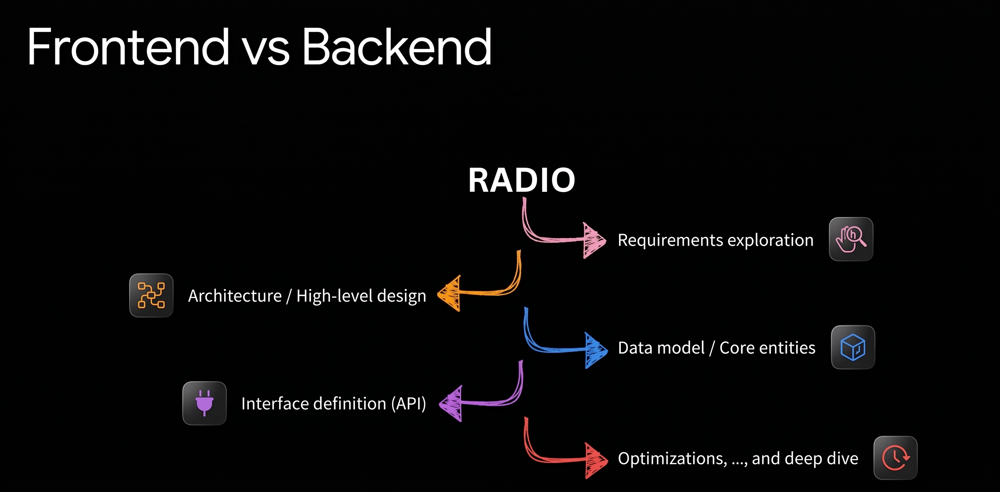

The **RADIO** framework is a simple, 5-step method to solve Frontend System Design problems during interviews or real projects[cite: 1, 6]. It helps you organize your thoughts before writing any code[cite: 1, 6].

### 1. R — Requirements exploration
Understand what you need to build before you start[cite: 1, 6]:
- **Functional requirements:** What features does the user see and use? (e.g., create a post, like a post, scroll infinitely).
- **Non-functional requirements:** Performance, fast load time, mobile support, offline mode, and accessibility (a11y).
- **Edge cases:** What happens if the internet disconnects? What if there are thousands of comments?

### 2. A — Architecture / High-level design
Draw the big picture of your app[cite: 1, 6]:
- How data moves between the client (browser) and the server[cite: 1, 6].
- Split the screen into main components (e.g., Feed, Post Card, Navigation bar)[cite: 1, 6].
- Choose the rendering strategy (e.g., Client-Side Rendering vs. Server-Side Rendering).

### 3. D — Data model / Core entities
Define how your data looks inside the app[cite: 1, 6]:
- **Main entities:** Object shapes for `User`, `Post`, `Comment`[cite: 1, 6].
- **Server state vs. UI state:**
  - **Server state:** Data coming from APIs (posts, profiles)[cite: 1, 6].
  - **UI state:** Local screen details (is a modal open? is it loading?).
- Keep your data clean and avoid duplicate data (normalization)[cite: 1, 6].

### 4. I — Interface definition (API)
Define how the frontend talks to the backend[cite: 1, 6]:
- Pick the communication type: REST API, GraphQL, or WebSocket (for real-time updates)[cite: 1, 6].
- Define endpoints, request parameters, and response formats[cite: 1, 6].
- Plan pagination: how to load more items when scrolling (page numbers vs. cursor-based)[cite: 1, 6].

### 5. O — Optimizations & Deep dive
Make your application fast, safe, and reliable[cite: 1, 6]:
- **Performance:** Virtual lists (render only visible items), lazy loading images, smaller bundle sizes[cite: 1, 6].
- **User experience (UX):** Optimistic updates (show the like button active immediately before the server responds)[cite: 1, 6].
- **Error handling:** Show clear error messages, auto-retry failed requests, and secure the app against attacks like XSS[cite: 1, 6].

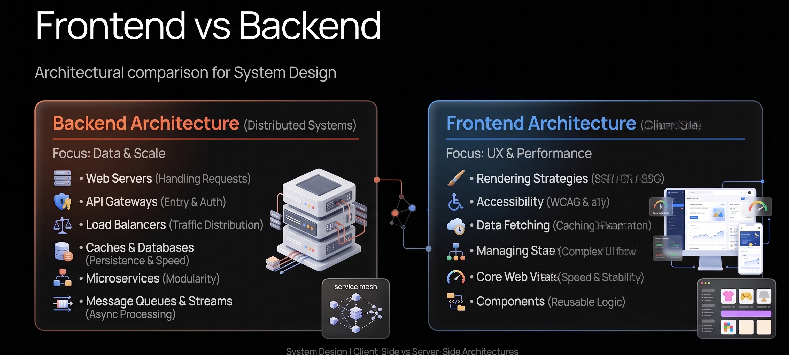
## Frontend vs Backend: System Design Comparison

When we talk about System Design, the frontend and backend have different goals and focus areas[cite: 8, 9]. The backend focuses on distributed systems and servers, while the frontend focuses on client-side architecture and user experience[cite: 8, 9].

### Backend: Distributed Systems (Focus: Data & Scale)
- **Web Servers:** Receive and handle incoming HTTP/network requests[cite: 8, 9].
- **API Gateways:** Single entry point for routing, authentication, and security[cite: 8, 9].
- **Load Balancers:** Distribute traffic across multiple servers to prevent crashes[cite: 8, 9].
- **Caches & Databases:** Store data safely (SQL/NoSQL) and speed up reads using cache (e.g., Redis)[cite: 8, 9].
- **Microservices:** Split the system into small, independent services[cite: 8, 9].
- **Message Queues & Streams:** Handle background tasks asynchronously (e.g., Kafka, RabbitMQ)[cite: 8, 9].

### Frontend: Client-Side Architecture (Focus: UX & Performance)
- **Rendering Strategies:** Choose how to display pages (SSR, CSR, SSG, or Hydration)[cite: 8, 9].
- **Accessibility (a11y):** Ensure the application is usable for everyone, including users with disabilities[cite: 8, 9].
- **Data Fetching:** Manage caching, pagination, polling, and network states on the client[cite: 8, 9].
- **Managing State:** Handle complex local and server data flows (e.g., Redux, Zustand, React Query)[cite: 8, 9].
- **Performance & Core Web Vitals:** Keep the web app fast, optimize bundle sizes, and prevent UI lag[cite: 8, 9].
- **Components:** Design reusable, modular, and maintainable UI logic[cite: 8, 9].

 ### FaceBook System Design
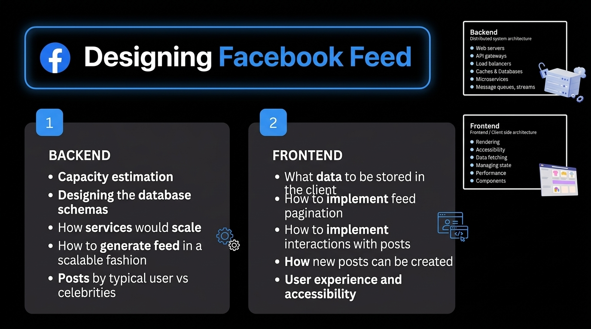

## Case Study: Designing Facebook Feed


To see the difference in practice, here is how backend and frontend engineers look at the same product (Facebook Feed) differently[cite: 10]:

### 1. Backend Scope
- **Capacity estimation:** Calculate storage, bandwidth, and read/write requests per second[cite: 10].
- **Designing database schemas:** Define tables and relationships for users, posts, and feeds[cite: 10].
- **Service scalability:** Scale services horizontally and handle high server traffic[cite: 10].
- **Scalable feed generation:** Fan-out strategies to deliver millions of posts efficiently[cite: 10].
- **Typical users vs. celebrities:** Handle users with millions of followers differently to protect servers[cite: 10].

### 2. Frontend Scope
- **Client-side data storage:** Decide what data stays in memory, LocalStorage, or IndexedDB[cite: 10].
- **Feed pagination:** Implement infinite scrolling and virtualized lists to save device memory[cite: 10].
- **Post interactions:** Handle likes and comments with instant (optimistic) feedback[cite: 10].
- **Creating new posts:** Autosave drafts and compress media before uploading[cite: 10].
- **User experience & accessibility:** Ensure smooth rendering, fast loading, and screen-reader support[cite: 10].


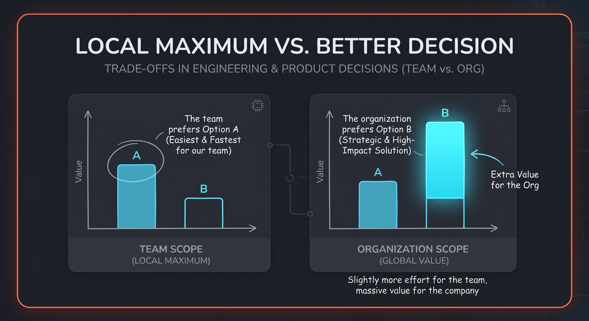

## Local Maximum vs. Better Decision (Org Value)

Sometimes engineers make decisions that are great for their own team, but not great for the whole company (organization).

- **Team Scope (Local Maximum):**
  - The team looks only at their own effort.
  - **Option A** looks better because it is faster, easier, and comfortable for the team right now.
  - **Option B** looks worse because it takes extra effort from the team.

- **Organization Scope (Global Value):**
  - When looking at the whole company, **Option B** gives huge extra value.
  - Even if Option B is slightly harder for one team, it saves money, speeds up other teams, and improves the overall system.

> **Key Rule:** A great senior engineer does not only optimize for their own comfort; they optimize for the whole organization.


## Software Architecture: Definitions & Concepts

### 1. What is Software Architecture? (4 Definitions)

Software architecture has multiple perspectives depending on how you look at the system[cite: 7, 8]:

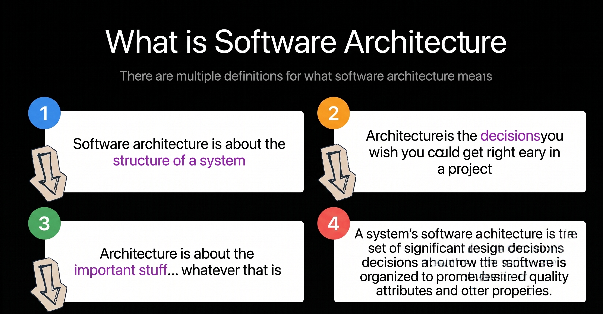

1. **System Structure:** Software architecture is about the structure of a system[cite: 7, 13].
2. **Early Critical Choices:** Architecture is the decisions you wish you could get right early in a project[cite: 8, 13].
3. **Core Priorities:** Architecture is about the important stuff... whatever that is[cite: 9, 13].
4. **Organizing for Quality:** Architecture is the set of significant design decisions about how the software is organized to promote desired quality attributes and properties[cite: 10, 13].

---

### 2. Architecture vs. Design

Architecture and design are not completely separate things; they exist on a continuous spectrum from high-level vision to detailed execution[cite: 14, 15]:

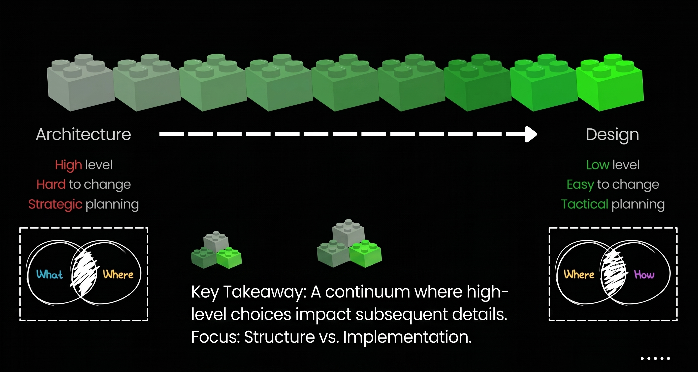

| Aspect | Architecture (High-Level) | Design (Low-Level) |
| :--- | :--- | :--- |
| **Questions Answered** | **What & Where** (Core modules and system boundaries)[cite: 14] | **Where & How** (Implementation details and patterns)[cite: 14] |
| **Flexibility** | **Hard to change** (Expensive and time-consuming to alter later)[cite: 14] | **Easy to change** (Local refactoring and quick iterations)[cite: 14] |
| **Planning Scope** | **Strategic planning** (Long-term system health and scalability)[cite: 14] | **Tactical planning** (Feature building and day-to-day coding)[cite: 14] |

---

### 3. Why Do We Need to Talk About This?

Distinguishing between architectural decisions and design decisions protects the engineering team and the product[cite: 16]:

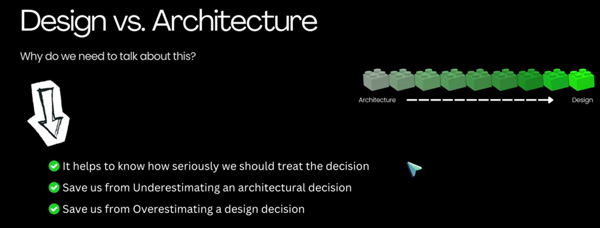

- **Calibrate Decision Weight:** It helps teams understand how seriously they must treat each choice before committing to it[cite: 16].
- **Avoid Underestimating Architecture:** Prevents making hasty, unresearched choices on fundamental system structures that are painful and costly to rewrite later[cite: 14, 16].
- **Avoid Overestimating Design:** Prevents "analysis paralysis" and time wasted debating small, tactical implementation details that can easily be changed at any time[cite: 14, 16].

### RADIO System.. 1 ) Requirement Exploration 

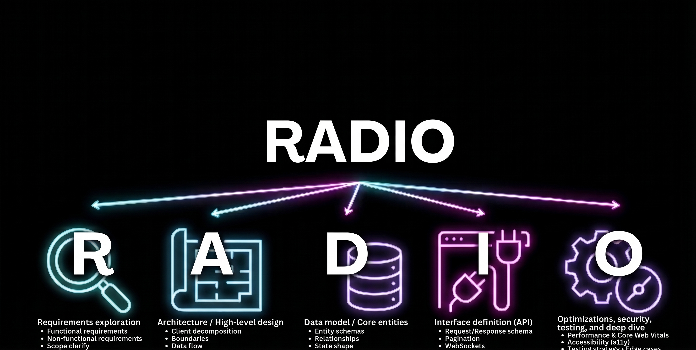
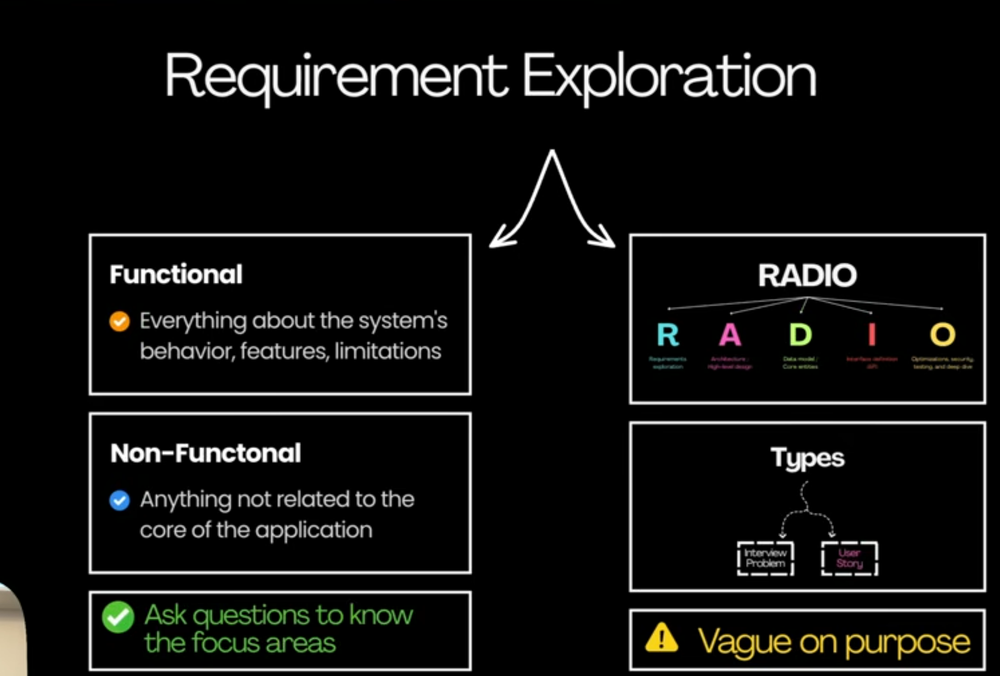

## Step 1: Requirement Exploration (R)

The primary goal of Requirement Exploration is to **eliminate ambiguity by asking targeted, high-impact questions** before writing code or drafting an architectural diagram.
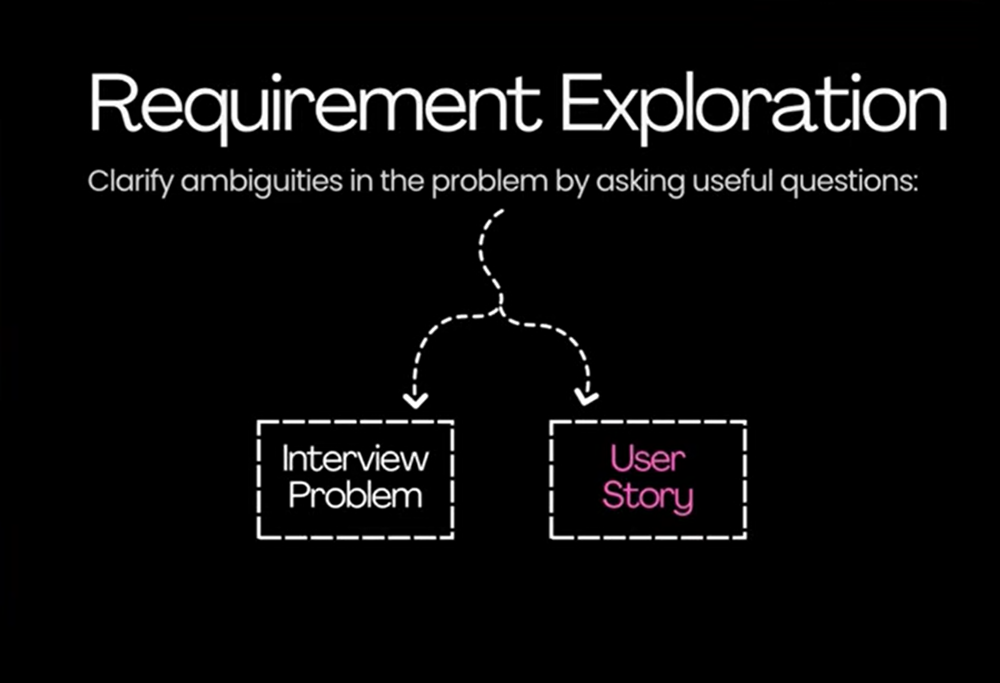

### Dealing with Open-Ended Problems

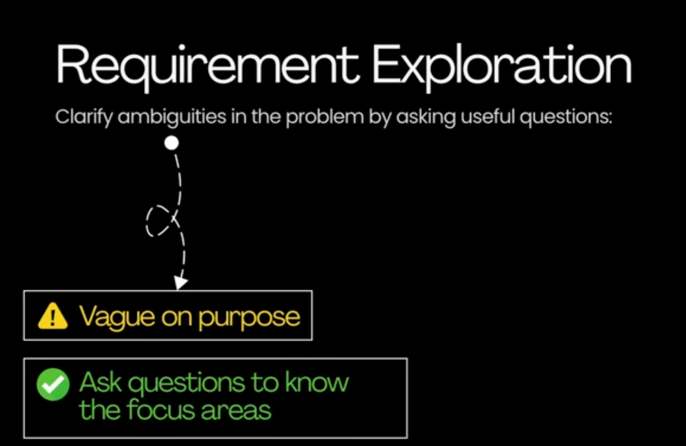

In a real-world project or system design interview, problem statements are often intentionally vague (e.g., *"Design an image feed"* or *"Build an autocomplete search component"*):
- **Why interviewers do this:** They want to observe your thought process, see how you handle uncertainty, and verify that you don't make blind assumptions.
- **Engineering mindset:** Jumping straight into component hierarchies or tech stacks is a red flag. Strong engineers pause, clarify the scope, establish hard boundaries, and align on expectations first.

---

### The Two Core Perspectives of Requirements

Requirement exploration breaks down into two complementary directions:


1. **Interview Problem (Technical Scope & Constraints):**
   - Focuses on engineering limitations, scale, and environment boundaries.
   - Clarifies supported devices (desktop vs. mobile web vs. hybrid), network conditions (offline-first vs. low latency), and volume targets (e.g., rendering thousands of items via virtualization instead of dumping everything into the DOM).

2. **User Story (UX & Interaction Flow):**
   - Focuses on user interactions and how data surfaces in the interface.
   - Clarifies step-by-step user behavior: what triggers a search, whether input debouncing is required, how filtering functions, and how empty, error, or loading states appear.

---

### Functional vs. Non-Functional Requirements

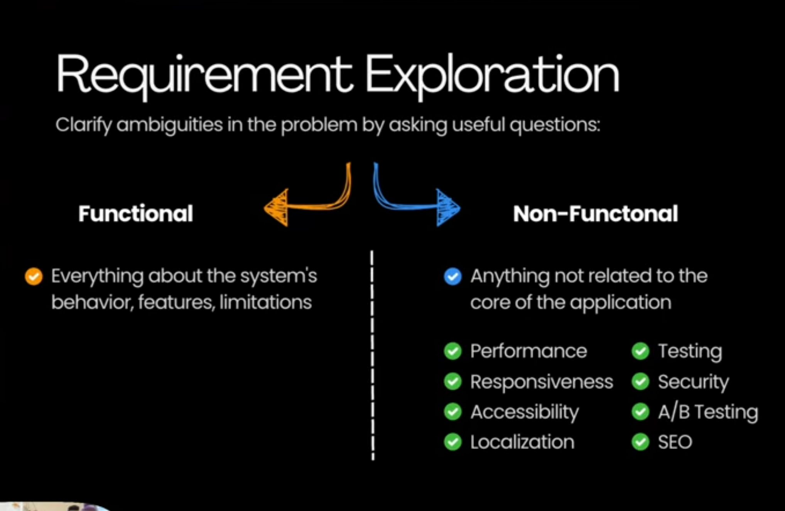

To structure questions effectively, group requirements into two distinct categories:

| Category | Definition | Key Frontend Questions & Examples |
| :--- | :--- | :--- |
| **Functional Requirements** | What the system **must do** (features & user flows). | - What core actions can the user perform (read, create, edit, delete)?<br>- What are the primary UI states (loading, empty, success, error)?<br>- What data filters and sorting options are required? |
| **Non-Functional Requirements** | How the system **must perform** (quality & constraints). | - **Performance:** What are the target Core Web Vitals (LCP, FID/INP, CLS) and initial load budgets?<br>- **Scalability:** How should the UI handle massive datasets (pagination, infinite scroll, windowing)?<br>- **Reliability & Offline:** Does the app need offline support or optimistic updates?<br>- **Accessibility & Devices:** Does it require keyboard navigation, screen reader support (ARIA), and cross-browser resilience? |


## FaceBook Feed Ex.

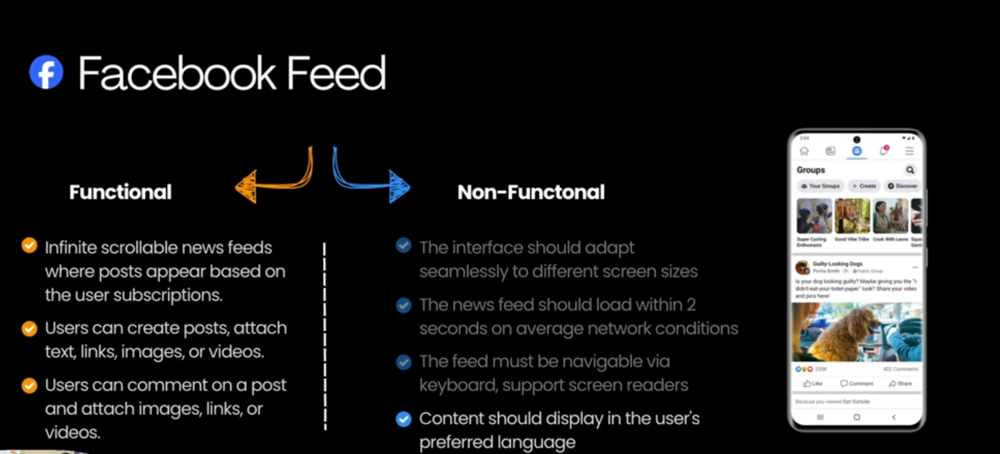


### Architecture / High-Level Design (A in RADIO)
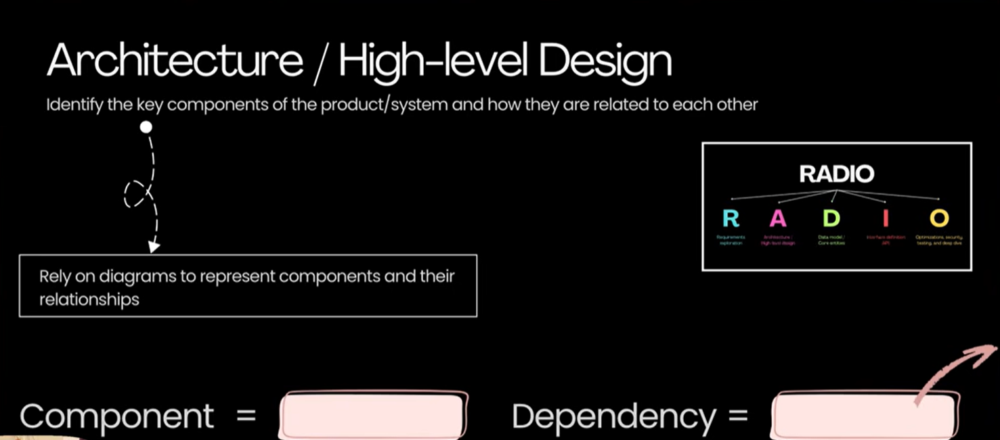
In this phase, our goal is to define the big picture of the system before writing any detailed code. We identify the core building blocks and show how data moves between them.

---

## 1. Core Concepts
* **Component (Node / Box):** A modular building block in the system (e.g., UI Module, Global Store, Controller, or Network Layer).
* **Dependency (Arrow / Edge):** Represents the relationship and direction of data flow between components (who triggers who, and where data comes from).

---

## 2. Steps to Follow
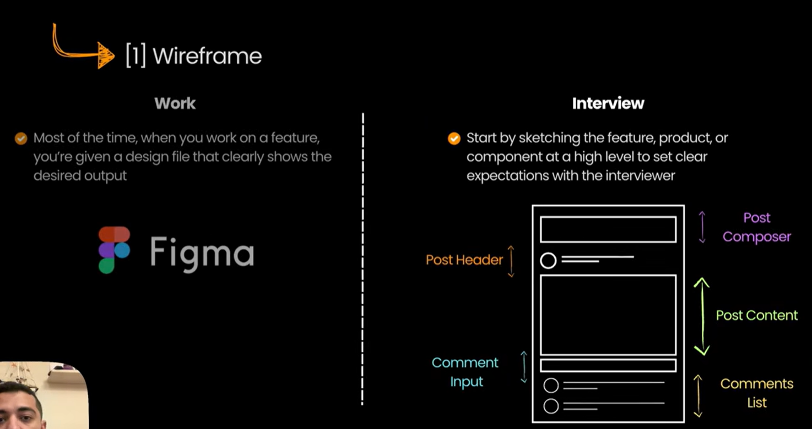

### Step 1: Wireframe (UI Breakdown)
* **Goal:** Understand the interface layout and identify the high-level UI sections.
* **Breakdown Example:**
  * Post Composer (creation area)
  * Post Header (user info and timestamps)
  * Post Content (text and media)
  * Comments List & Comment Input

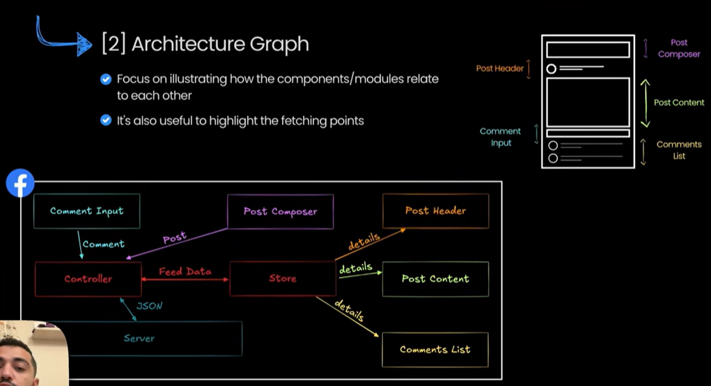
### Step 2: Architecture Graph (Data Flow & Services)
* **Goal:** Map the relationship between the UI, data storage, and the backend.
* **Flow:**
  * **User Action:** UI components (like `Post Composer` or `Comment Input`) send actions to the `Controller`.
  * **Network Communication:** The `Controller` makes HTTP/WebSocket requests to the `Server`.
  * **State Management:** Responses are stored in the `Store` (Server Cache / Global State).
  * **Reactive UI:** Visual components subscribe to the `Store` and re-render with the latest data.

---

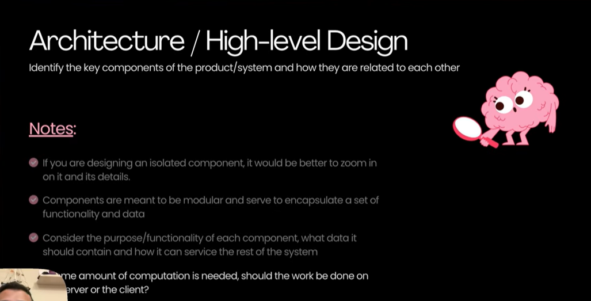

## 3. Best Practices to Keep in Mind
* **Modularity:** Keep each component focused on a specific job with clear boundaries.
* **Separation of Concerns:** Separate data fetching and state management from rendering UI.
* **Server vs. Client Balance:** Decide early what computations belong on the client vs. what should be calculated on the backend..

# Phase 3: Data Model / Core Entities (D in RADIO)


In this phase, we identify what data exists in our application, where it comes from, and where it lives on the client.

---

## 1. Data Classification by Source
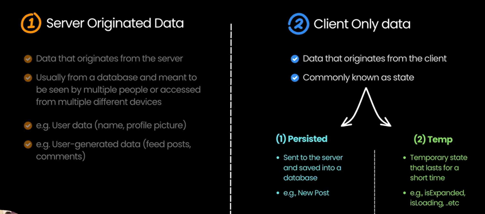

### 1. Server Originated Data
* Data that comes directly from the backend database.
* Accessed by multiple users or across multiple devices.
* **Examples:** User profiles, feed posts, and comments.

### 2. Client Only Data (State)
* Data created and managed inside the client app.
* Divided into two categories:
  * **Persisted:** Created locally and then sent to the server (e.g., draft content for a new post).
  * **Temp (Ephemeral):** Short-lived state that is never saved to a database (e.g., `isLoading`, `isExpanded`, modal toggles).

---

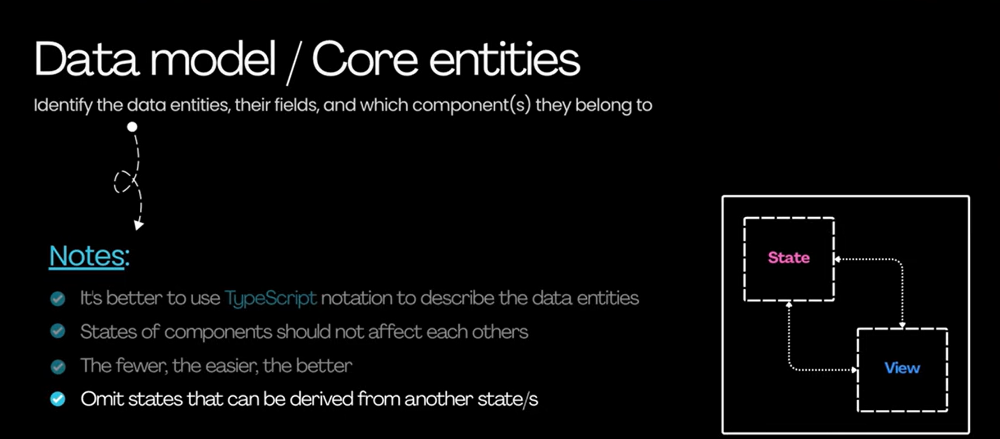
## 2. Core Entities Table

| Source | Entity | Belongs to | Fields |
| :--- | :--- | :--- | :--- |
| **Client** | New Post | Composer | post content, media (image, video) |
| **Server** | User | Store | id, username, profile_pic |
| **Server** | Post | Store | id, date, content, media, comments |

---

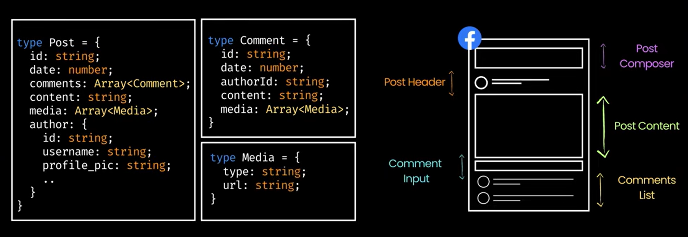
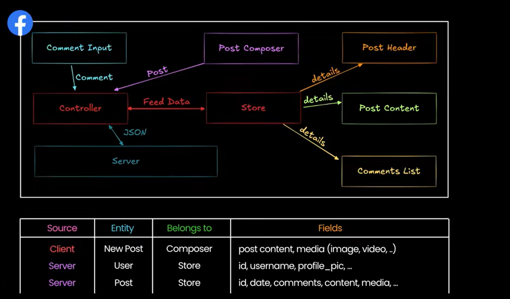
## 3. Best Practices
* **Use TypeScript:** Describe entities with clear TypeScript types or interfaces.
* **Keep It Minimal:** Store only essential data; fewer state variables mean fewer bugs.
* **Omit Derived State:** Never store values that can be computed from existing data (e.g., calculate `itemsCount` via `items.length`).
* **Component Isolation:** Ensure component states stay encapsulated and do not interfere with each other.

# Phase 4: Interface & API Definition (I in RADIO)
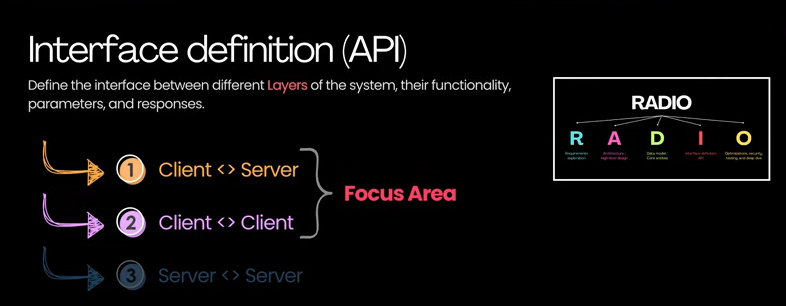

In this phase, we design the contracts (Interfaces) that allow different parts of our system to communicate. An API isn't just for communicating with a server; it also defines how components talk to each other.

---

## 1. Types of Interfaces

### A. Client <=> Server (Network API)
* Uses **HTTP Calls** (GET, POST, etc.) to request or send data to the backend.
* **Inputs:** Request Method, Query Params, Path Params, and Request Body.
* **Outputs:** HTTP Response (usually in JSON format).

### B. Client <=> Client (Component API)
* Uses **JS Functions, Events, and Props** to send data between UI components (like Parent to Child).
* **Inputs:** Props & Function arguments.
* **Outputs:** Rendered UI components or Returned function values.

---

## 2. The Three Pillars of any API

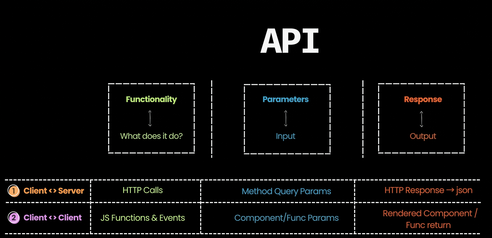

1. **Functionality:** What does it do? (e.g., "Fetch the user's feed").
2. **Parameters (Input):** What does it need? (e.g., limit, offset/cursor, or forms data).
3. **Response (Output):** What does it return? (e.g., the requested data, error messages, or metadata).

---

## 3. Real-World Example: Paginated Feed API (`Client <=> Server`)
 
 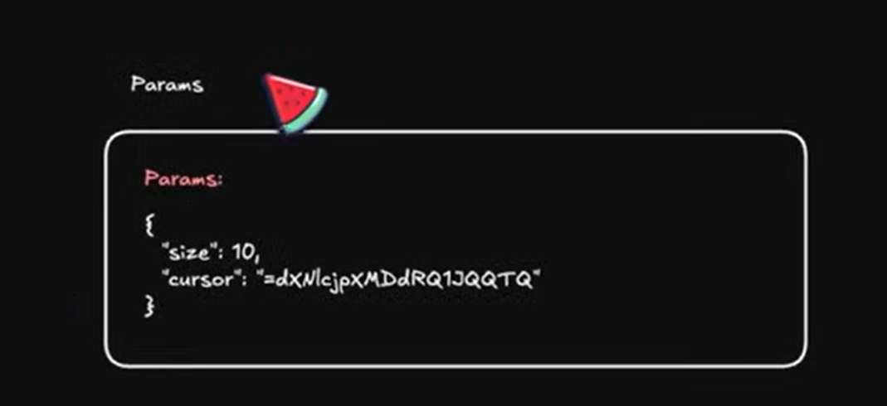
 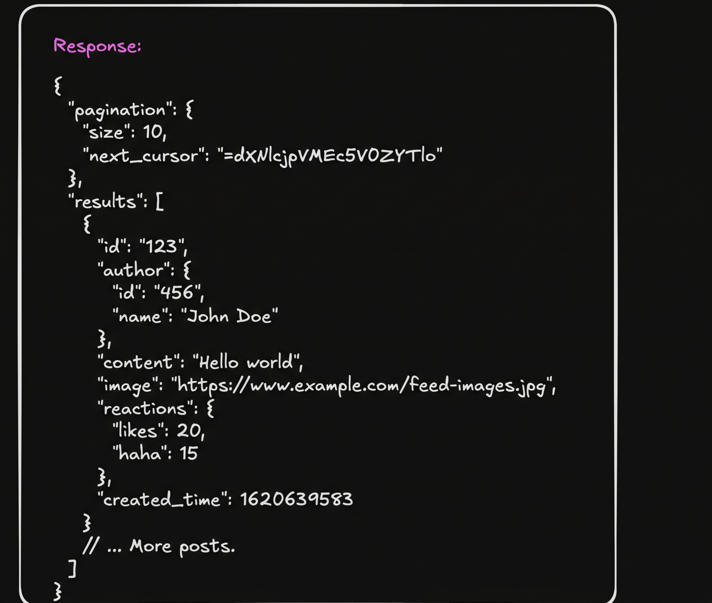
When users scroll their feed, we use **Infinite Scrolling** with Pagination to fetch posts in chunks (small batches) so the app stays fast.

### High-Level API Design

* **Functionality:** Fetch the user's home feed posts (`GET /api/v1/feed`).
* **Parameters (Inputs):**
  * `size`: The number of posts to fetch (e.g., `10`).
  * `next_cursor`: A string pointer to know where the next batch of posts starts (sent as `""` for the first request).

* **Response (Output):**
```json
{
  "pagination": {
    "size": 10,
    "next_cursor": "=dxNlcjpVMEC5VOZYTlo"
  },
  "results": [
    {
      "id": "123",
      "author": {
        "id": "456",
        "name": "John Doe"
      },
      "content": "Hello world",
      "image": "[https://www.example.com/feed-images.jpg](https://www.example.com/feed-images.jpg)",
      "reactions": {
        "likes": 20,
        "haha": 15
      },
      "created_time": 1620639583
    }
    // ... More posts (up to 10)
  ]
}
```
 #### How the Pagination Flow Works:
 - The client sends a request asking for 10 posts.

 - The server responds with 10 posts and a token called next_cursor.

 - As the user scrolls near the bottom of the feed, the client automatically triggers a new fetch.

 - The client sends the next_cursor back to the server to get the next 10 posts, preventing any duplicate data or loading issues.

 # Phase 5: Optimizations & Deep Dive (O in RADIO)
  
In this final phase, we take our working system design and make it production-ready. We focus on scaling, performance, security, and real-world edge cases.

---

## 1. Key Optimization Pillars
 
### A. Performance & Rendering
* **List Virtualization (Windowing):** Render only visible items on screen to keep memory usage low during infinite scrolling.
* **Asset Optimization:** Lazy-load offscreen images and use modern formats (WebP/AVIF).
* **Optimistic Updates:** Update the UI immediately after user actions (like Likes) to give an instant feel, then sync with the server.

### B. Network & Data Layer
* **Smart Caching:** Cache server responses locally (via TanStack Query or HTTP Caching) to eliminate duplicate calls.
* **Debouncing & Throttling:** Limit rapid triggers on search inputs and window scroll events.

### C. Security
* **XSS Defense:** Sanitize any user-generated HTML or text before rendering.
* **CSRF & Tokens:** Store sensitive auth tokens securely (e.g., HttpOnly cookies).

### D. Localization (i18n / L10n) & Accessibility (a11y)
* **Localization:** Support RTL/LTR layouts smoothly and split translation bundles per language.
* **Accessibility:** Use proper semantic HTML, ARIA tags, and full keyboard navigation.

### E. Testing & Resilience
* **Error Boundaries:** Prevent the entire UI from crashing if one component fails.
* **Testing:** Cover critical workflows with integration and end-to-end (E2E) tests.

---

## 2. Interview Strategy
* **Follow the Lead:** Answer the interviewer's specific concerns first if they target a certain topic (e.g., performance or security).
* **Drive with Strengths:** If given the floor, deep-dive into the areas most critical to the system (e.g., virtualization for a social feed, or caching for real-time dashboards).

# Component API Design & Styling Architecture
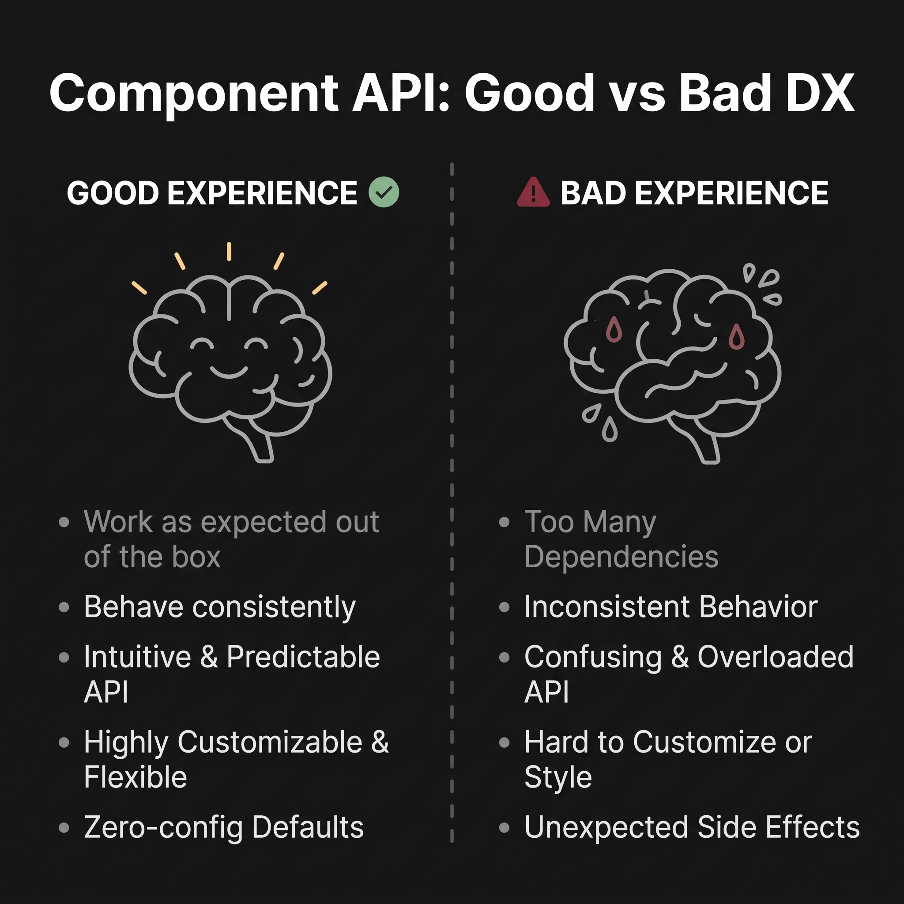

Working with frontend components can be a great experience or a daily headache, depending on how you design and maintain their APIs. A well-designed component API improves Developer Experience (DX), prevents bugs, and ensures long-term maintainability.

---

## Component API: Good vs Bad DX

### Good Experience (Good DX)
* **Works out of the box:** Works immediately with sensible default values without requiring complex setup.
* **Behaves consistently:** Acts predictably and reliably everywhere across the entire app.
* **Intuitive and clear API:** Uses familiar, standard names that developers can guess without checking docs.
* **Highly customizable:** Flexible enough to adapt content and styling without breaking the component.
* **Zero unexpected side effects:** Stays self-contained and never leaks styles or breaks outside layout.

---

### Bad Experience (Bad DX)
* **Too many dependencies:** Relies on too many external packages that make the project heavy.
* **Inconsistent behavior:** Changes how it works unexpectedly from one page to another.
* **Confusing and overloaded API:** Uses strange prop names, conflicting flags, or too many props.
* **Hard to customize:** Closed structure that forces you to edit the original component file for small changes.
* **Unexpected side effects:** Causes layout shifts, breaks global scroll, or changes shared state silently.

---

## 1. Make Impossible States Impossible
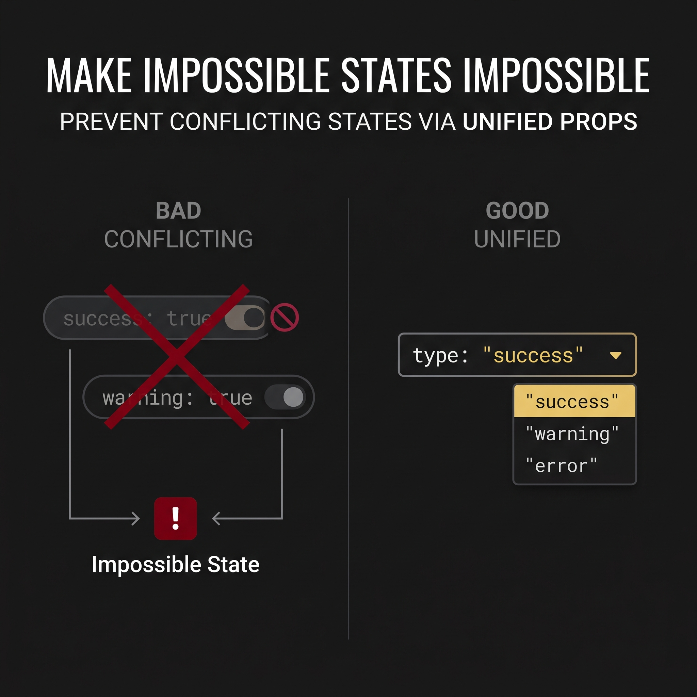

Never let your component accept options that conflict with each other. If two states cannot exist together in real life, your component must make them impossible to use at the same time.

### The Problem
Using multiple boolean flags makes conflicting states possible, creating confusing behavior:

```js
// Bad DX: Conflicting props - which one wins?
<Alert success warning>Data saved successfully</Alert>
```

### The Solution
Replace multiple boolean props with a single prop that accepts specific values:

```js
// Good DX: Only one state can be selected at a time
<Alert type="success">Data saved successfully</Alert>
```

---

## 2. Less Is More (Avoid the "God Component")
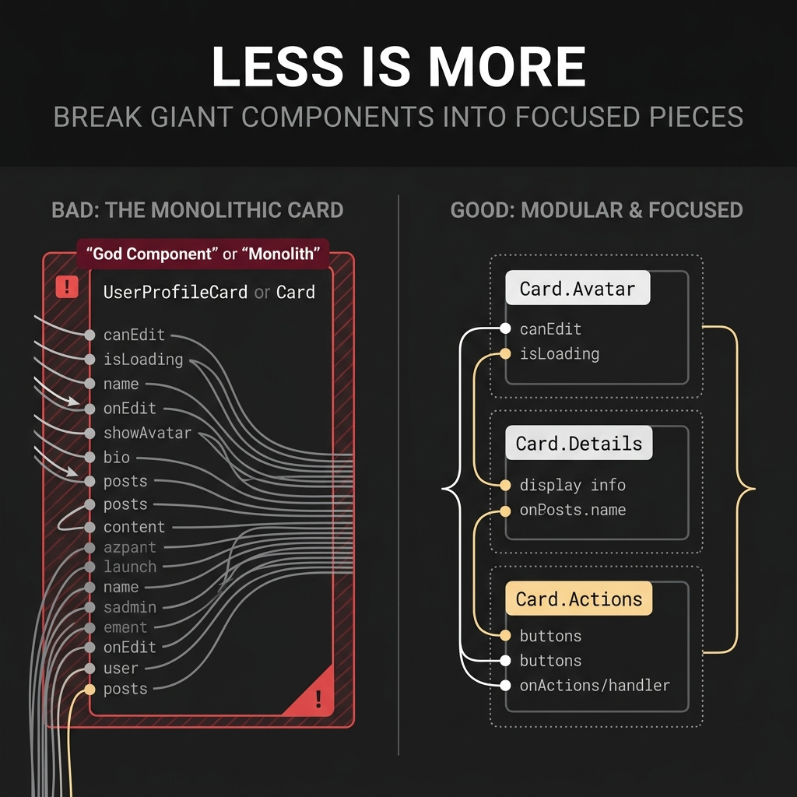

Do not build a single giant component that tries to handle all data, permissions, and layout logic through dozens of props. When a component does too much, it becomes difficult to read, maintain, and test.

### The Problem
A bloated component with an endless list of props:

```js
// Bad DX: Hard to remember all props, rigid, and easy to break
<UserProfileCard
  name="John Doe"
  showAvatar={true}
  canEdit={true}
  isLoading={false}
  onEdit={handleEdit}
/>
```

### The Solution
Follow the Single Responsibility Principle and break the component down into smaller, composable pieces (Compound Components):

```js
// Good DX: Clean, modular, and easy to adjust
<UserCard>
  <UserCard.Avatar src="/avatar.png" />
  <UserCard.Details name="John Doe" email="john@example.com" />
  <UserCard.Actions>
    <Button onClick={handleEdit}>Edit</Button>
  </UserCard.Actions>
</UserCard>
```

---

## 3. Be Consistent
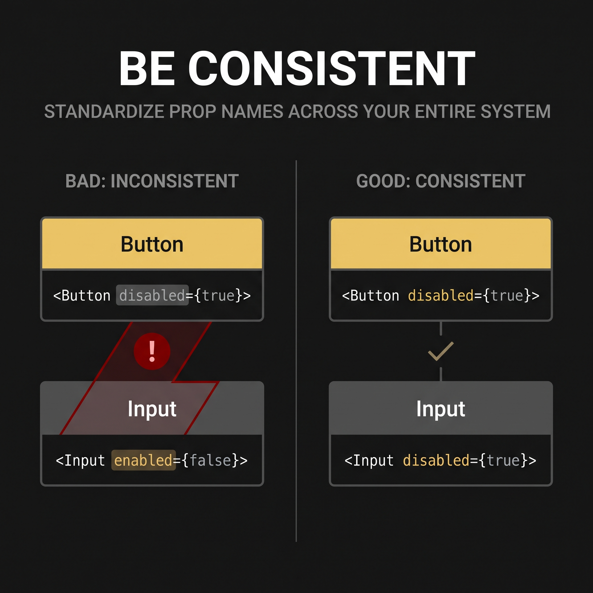

Always use predictable and consistent names for props across all components in your project. When multiple components share the same function, their prop names must match.

### The Problem
Using different names for the exact same function confuses developers:

```js
// Bad DX: Different names for the disabled state
<Button disabled={true}>Submit</Button>
<Input enabled={false} placeholder="Enter name" />
```

### The Solution
Standardize the prop name across your whole component library:

```js
// Good DX: Predictable and consistent everywhere
<Button disabled={true}>Submit</Button>
<Input disabled={true} placeholder="Enter name" />
```

---

## 4. Use Types / Prop Validation
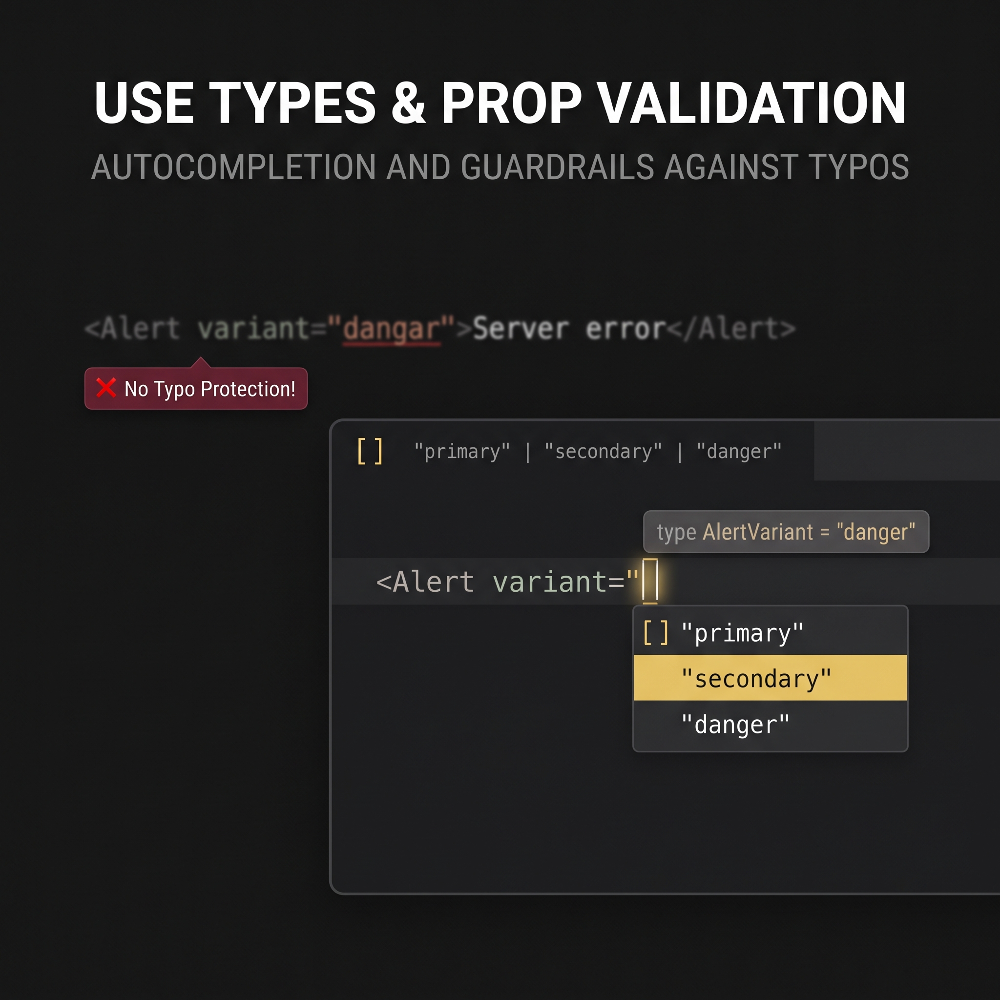

Even when using plain JavaScript, always validate the props your component accepts. Restricting values helps prevent silent bugs and annoying typos.

### The Problem
Allowing plain, open strings lets typos slip through unnoticed and breaks styling:

```js
// Bad DX: A simple typo silently breaks the layout
<Alert type="dangar">Server error occurred</Alert>
```

### The Solution
Define a clear list of allowed values to catch errors early:

```js
// Good DX: Explicit allowed values and safe fallbacks
const ALLOWED_TYPES = ['info', 'success', 'warning', 'danger'];

function Alert({ type = 'info', children }) {
  const safeType = ALLOWED_TYPES.includes(type) ? type : 'info';
  return <div className={`alert alert-${safeType}`}>{children}</div>;
}
```

---

## 5. Be Clear (Avoid Fancy Slang)
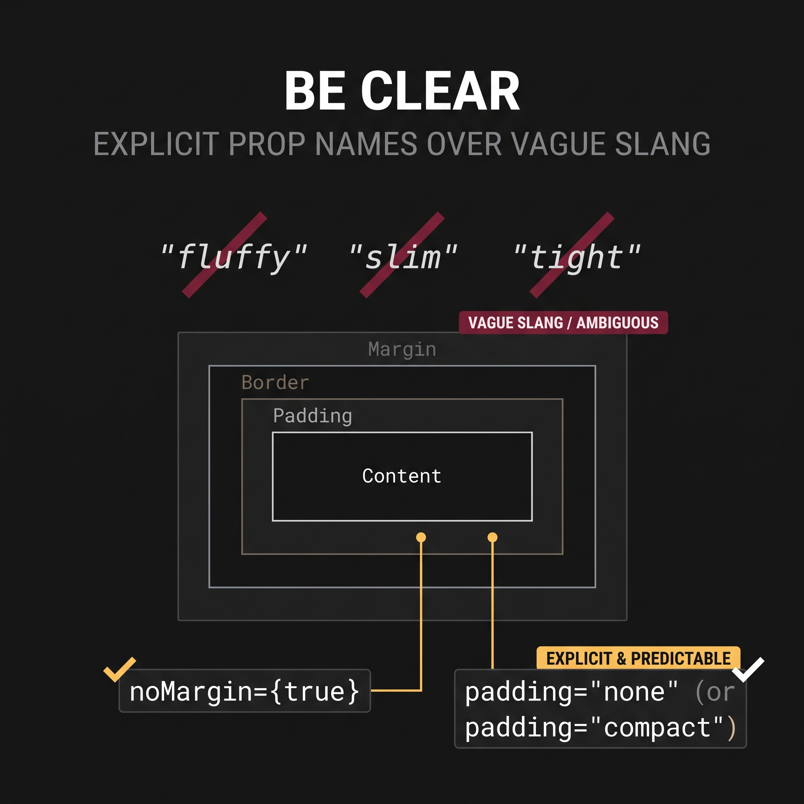

Give your props explicit names that state exactly what they change. Clever or slang names might look fun at first, but they quickly create confusion for anyone else reading the code.

### The Problem
Vague, decorative names make it impossible to guess what the prop actually does:

```js
// Bad DX: What do 'fluffy' or 'slim' actually control?
<Card fluffy />
<Button slim />
```

### The Solution
Use direct, self-explanatory names:

```js
// Good DX: Clear, direct, and self-explanatory
<Card padding="large" />
<Button noMargin={true} />
```

---

# Component Styling Architecture

Styling is a core part of frontend architecture. A well-designed styling system makes components reusable and easy to customize without breaking application layout.

---

## 1. Architectural Forces & The Strategy Trade-off

When designing a component styling system, four architectural forces balance against each other. Improving one force often requires a trade-off with another.

### The 4 Core Architectural Forces

1. **Flexibility (Handling Edge Cases):**
   - **What it means:** How easily developers can adjust colors, spacing, or visual layout for special use cases.
   - **Why it matters:** Real-world applications always have unique pages or edge cases that do not fit standard design defaults.

2. **Consistency (System Integrity):**
   - **What it means:** Enforcing unified design tokens (colors, typography, spacing) across all screens.
   - **Why it matters:** Protects visual harmony and ensures the product feels cohesive and professional.

3. **Predictability (Cascade & Specificity Safety):**
   - **What it means:** Knowing exactly how a component will render without style collisions or cascade surprises.
   - **Why it matters:** CSS is global by nature. If styles depend on class specificity tricks or file bundle order, unexpected visual bugs occur.

4. **Scalability (Team & Codebase Growth):**
   - **What it means:** Growing the component library and team without introducing style regressions or technical debt.
   - **Why it matters:** As projects scale to hundreds of components and dozens of developers, fragile CSS leads to high maintenance costs.

---

### The Strategy Trade-Off: Global Theming vs. Per-Instance Customization

Should styles be controlled strictly from a central system, or modified freely at each component instance?

```
Strict Design Rules <===============================> Maximum Customization
[ Global Theming Only ]                             [ Per-Instance Overrides ]
• High Consistency                                  • High Flexibility
• Predictable & Safe                                • Risk of Style Drift
• Slower for Edge Cases                             • Higher Complexity
```

* **Global Theming (Centralized Control):**
  * **Mechanism:** Controls appearance using shared design tokens (such as CSS custom properties or theme objects).
  * **When to choose:** Best for mature design systems, enterprise apps, and multi-brand platforms where brand consistency is non-negotiable.
  * **Trade-off:** High consistency and predictability, but rigid when an engineer needs an isolated tweak for a one-off screen.

* **Per-Instance Customization (Local Overrides):**
  * **Mechanism:** Allows consumers to pass local overrides directly to components (via `className`, `style`, or custom hooks).
  * **When to choose:** Best for fast-moving product teams, landing pages, or complex dashboard widgets with unique layout needs.
  * **Trade-off:** Fast iteration and high flexibility, but increases the risk of "design drift" (inconsistent visual rules) and CSS conflicts.

* **Key Decision Factors:**
  * **Team Structure:** Central design system teams favor global theming; independent feature squads often demand per-instance escape hatches.
  * **Design Maturity:** Early-stage products need flexibility to experiment; mature products enforce strict theme constraints.
  * **Project Scope:** Multi-brand white-label applications require central theming; bespoke one-off marketing sites favor local customization.

---

## 2. Component Appearance Customization Patterns (Deep-Dive)

There are four primary patterns for component appearance customization. Each pattern serves different architectural requirements.

---

### Pattern 1: Inline CSS (`style` prop)
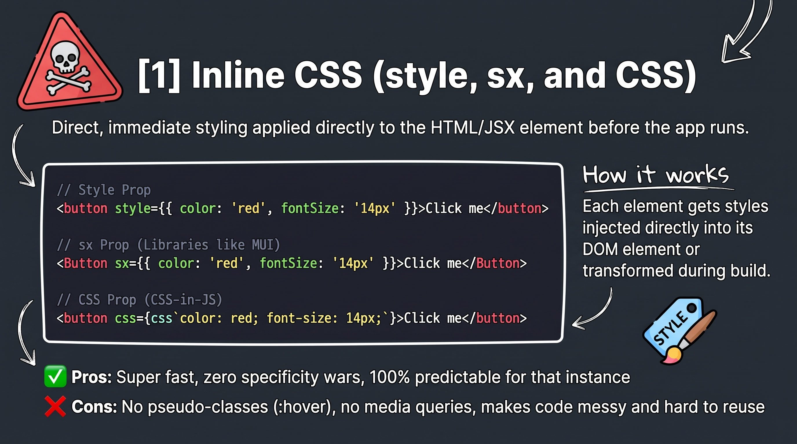

#### Concept
Passing a JavaScript style object directly to the element's `style` attribute. Styles are applied directly to the DOM node.

#### Example
```jsx
// Component implementation
function Button({ style, children }) {
  return (
    <button className="btn-base" style={style}>
      {children}
    </button>
  );
}

// Consumer usage
<Button style={{ backgroundColor: '#2563eb', padding: '10px 20px' }}>
  Save Changes
</Button>
```

#### Use Cases
- Dynamic values calculated at runtime by JavaScript (e.g., coordinates, progress bar percentage, drag-and-drop offsets).
- Quick prototyping when writing dedicated classes is unnecessary.

#### Pros & Cons
* **Pros:**
  * **Complete Flexibility:** Any valid CSS property can be applied immediately.
  * **Immediate Override:** Inline styles have higher specificity than standard CSS classes.
  * **Zero Class Collisions:** Styles attach directly to the DOM element without class name conflicts.
* **Cons:**
  * **CSS Wars:** Extremely difficult to override downstream without using `!important`.
  * **No Pseudo-states or Media Queries:** Cannot handle `:hover`, `:focus`, `:active`, or `@media` responsive breakpoints.
  * **Pollutes the DOM:** Inflates HTML size with repeated inline attributes.
  * **Harms Maintainability:** Blends visual styling logic directly into application business logic.

---

### Pattern 2: Class Injection (`className` prop)
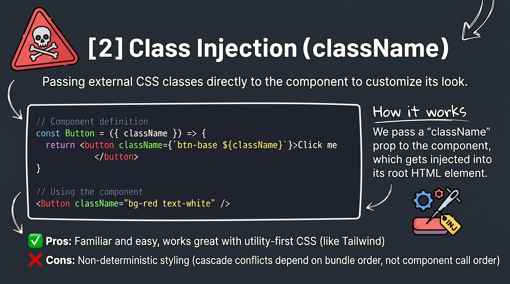

#### Concept
Exposing a `className` prop on the component so consumers can pass external CSS classes or utility classes (e.g., Tailwind CSS) directly to the root element.

#### Example
```jsx
// Component implementation
function Card({ className = '', children }) {
  return (
    <div className={`card-root ${className}`.trim()}>
      {children}
    </div>
  );
}

// Consumer usage (e.g., with utility classes)
<Card className="rounded-xl shadow-lg bg-white p-6">
  <h2>Order Details</h2>
</Card>
```

#### The Non-Deterministic Styling Issue
Passing classes seems simple, but it creates a classic CSS problem: **specificity conflicts determined by bundle order**.

In CSS, if two classes have identical specificity (such as `.card-root` and `.custom-card`), the rule declared **later in the generated CSS bundle wins**—regardless of the order classes appear in the HTML `className` string.

```css
/* In bundle.css */
.custom-card { background: red; }
.card-root   { background: white; } /* card-root declared later! */
```

```jsx
/* Even though custom-card is passed last, the background stays white! */
<div className="card-root custom-card" />
```

If code-splitting or route changes alter the load order of stylesheets in production, components can suddenly change appearance without code changes.

#### Use Cases
- Integration with utility-first CSS frameworks (Tailwind CSS, UnoCSS).
- Adjusting external layout properties (such as margins, flex grow, or grid placement) from a parent container.

#### Pros & Cons
* **Pros:**
  * **Familiar & Standard:** The most common pattern in modern component libraries.
  * **Utility-Friendly:** Works smoothly with utility systems and helper libraries like `clsx` or `tailwind-merge`.
  * **Full CSS Capabilities:** Supports hover states, animations, and responsive queries.
* **Cons:**
  * **Non-Deterministic Cascade:** High risk of collision if passed classes override internally defined properties.
  * **Leaky Abstraction:** Consumers can override core layout rules (like `display: flex`) and break internal component mechanics.

---

### Pattern 3: CSS Selector Hooks (Internal Classes & Data Attributes)
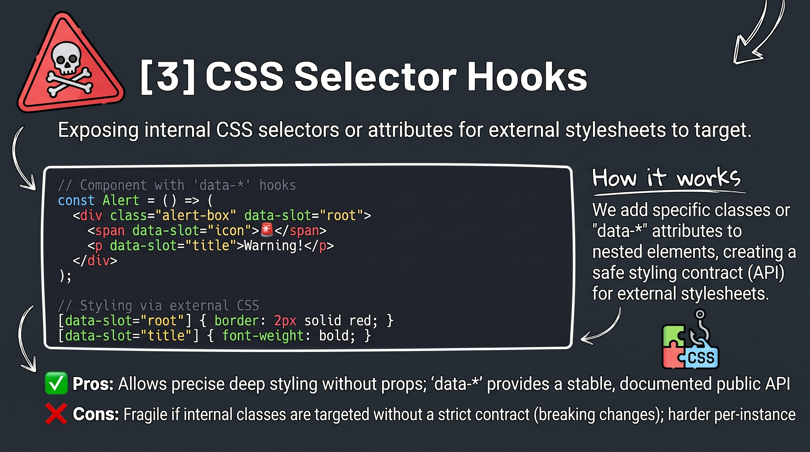

#### Concept
Exposing predictable selector hooks inside multi-part components so external stylesheets can target nested elements without changing component code.

#### DevTools Inspectability vs. Non-Deterministic Fragility
When inspecting components using browser **DevTools (Inspect Element)**, class names make it simple to understand the DOM tree and locate nested elements. This inspectability makes internal classes tempting to target.

However, relying on arbitrary internal classes (such as `.alert-box`, `.alert-title`) is a dangerous trap:
1. **Non-Deterministic Cascade:** When external stylesheets target internal classes, specificity collisions can occur depending on which stylesheet loaded last.
2. **Coupling to Implementation:** Arbitrary class names are private implementation details. If the component author refactors the internal HTML or renames a class, external styles silently break with zero warnings.

#### The "Unless" Rule (Safe Contracts)
Styling internal elements with classes is safe **ONLY IF** those classes are an officially documented, public API contract. The author guarantees that renaming or removing the class is treated as a breaking change.

#### The Modern Solution: Stable Attribute Selectors (`data-*`)
Instead of arbitrary class names, modern component architectures use **element attribute selectors** (like `data-slot`, `data-state`, and `data-loading`) as official styling hooks:
- **Easy DevTools Inspection:** Attributes like `data-slot="title"` or `data-loading="true"` remain crystal-clear to read in browser DevTools.
- **Stable Public Contract:** The attribute is a deliberate, documented hook. You can safely refactor internal HTML tags and internal classes without breaking consumer styling.
- **Predictable State Hooks:** Directly maps UI states (e.g., `[data-state="open"]`, `[data-loading="true"]`) without fragile class toggling.

#### Example
```jsx
// Component implementation with data attribute contracts
function Alert({ state = 'open', loading = false, children }) {
  return (
    <div
      className="alert-root"
      data-slot="root"
      data-state={state}
      data-loading={loading}
    >
      <span data-slot="icon">🚨</span>
      <div data-slot="content">{children}</div>
    </div>
  );
}
```

```css
/* External stylesheet targeting stable data-* contracts */
[data-slot="root"] {
  border: 1px solid #e2e8f0;
  padding: 16px;
}

[data-slot="root"][data-loading="true"] {
  opacity: 0.6;
  pointer-events: none;
}

[data-slot="icon"] {
  margin-right: 8px;
}

[data-slot="content"] {
  font-weight: 500;
}
```

#### Use Cases
- Multi-part compound components (Modals, Menus, Accordions, Tabs).
- Headless UI component libraries (such as Radix UI, Ark UI, or Zag.js).

#### Pros & Cons
* **Pros:**
  * **Clean DevTools Inspection:** Element states and slots are easy to identify in the Elements panel (`data-slot="icon"`, `data-loading="true"`).
  * **Stable Semantic Contracts:** Component markup can be refactored internally without breaking consumer styling.
  * **Separation of Concerns:** Clear boundary between internal structure and external theme rules.
* **Cons:**
  * **Requires Contextual Selectors:** Consumers must write attribute selectors (`[data-slot="..."]`), making single-line prop overrides harder.
  * **Cascade Order:** Still susceptible to cascade order conflicts if styles are not properly scoped or layered.

---

### Pattern 4: CSS Preprocessor Compilation (Build-time Customization)
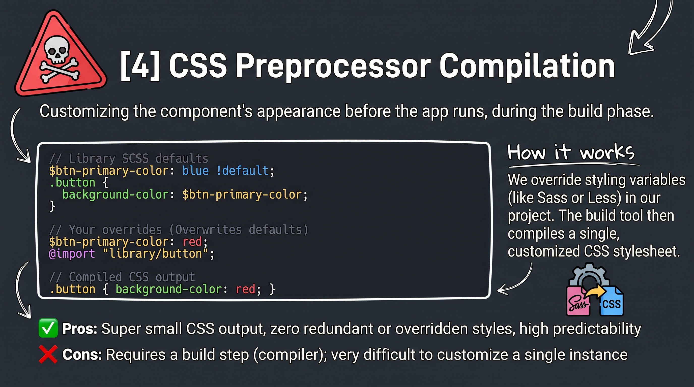

#### Concept
Customizing component styles at build time using preprocessor variables (such as Sass or Less) instead of runtime JavaScript or CSS overrides.

#### The Mechanics (`!default` flag)
The component library defines default values using the Sass `!default` flag:
- The `!default` flag tells the compiler: *"Only set this value if the variable has not been defined yet."*
- The consuming application defines its custom variables **before** importing the library stylesheet.

#### Example
```scss
/* _button.scss (Component Library) */
$btn-bg-primary: #0d6efd !default;
$btn-radius: 4px !default;
$btn-padding: 8px 16px !default;

.btn-primary {
  background-color: $btn-bg-primary;
  border-radius: $btn-radius;
  padding: $btn-padding;
}
```

```scss
/* main.scss (Consumer Application) */
// 1. Define custom theme values first
$btn-bg-primary: #10b981; // Brand green override
$btn-radius: 9999px;      // Pill button override

// 2. Import the component stylesheet second
@import 'button';
```

#### Compiled Output
```css
/* Final bundle.css */
.btn-primary {
  background-color: #10b981;
  border-radius: 9999px;
  padding: 8px 16px;
}
```

#### Use Cases
- Large design system libraries (e.g., Bootstrap, Ant Design Sass/Less themes).
- White-label products where different clients receive custom-branded CSS builds from the same codebase.

#### Pros & Cons
* **Pros:**
  * **Lean CSS Bundle:** Only final compiled styles exist in the CSS file; zero redundant override rules.
  * **High Build-Time Predictability:** Broken variables or syntax errors fail early during build time.
  * **Zero Runtime Overhead:** No browser-side JavaScript or CSS-in-JS style recalculations.
* **Cons:**
  * **Requires a Build Step:** Cannot dynamically change values at runtime without switching whole stylesheets.
  * **Difficult for Per-Instance Styling:** Variable changes affect all components globally; styling a single unique button requires extra utility classes.

---

### Pattern Summary

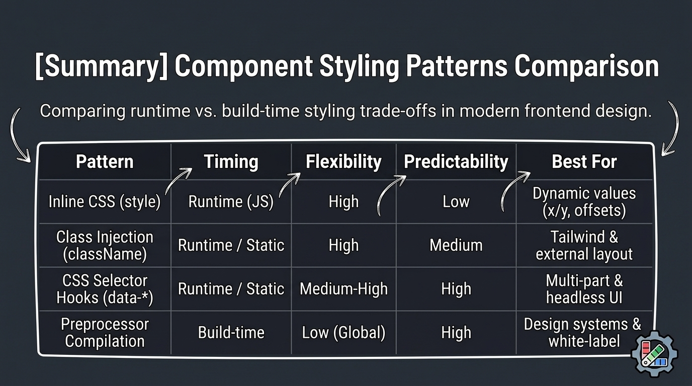

